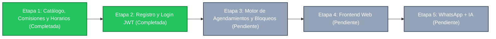

# Roadmap — SaaS Barberías y Salones

Documento vivo del progreso real del proyecto. Se actualiza al cerrar cada etapa o módulo verificado en `main`.

## Mapa Visual del Proyecto

> **Leyenda:** Verde = Completada · Azul = En curso · Gris = Pendiente

---

## Checklist Detallado

### Base e Infraestructura
- [x] Setup TypeScript (`strict`), Fastify 5, Drizzle ORM + PostgreSQL, Zod 4 y Vitest
- [x] Migraciones SQL versionadas (`0000`–`0003`: `companies`, `collaborators`, `services`, `collaborator_services`, `work_schedules`)
- [x] Manejador centralizado de errores (`src/shared/http/error-handler.ts`)
- [x] Swagger / OpenAPI UI en `/docs` (habilitado solo fuera de producción)
- [x] Hashing y comparación segura de contraseñas con `bcrypt` (`BcryptPasswordHasher`)
- [x] Middleware JWT + RBAC (`authenticate` / `authorizeRoles`) con validación de estado activo en sesiones
- [x] Rutas base iniciales de creación (`POST /companies`, `POST /collaborators`)
- [x] Proteger `POST /collaborators` con JWT de `OWNER`, validar unicidad global de correo y documentarlo en Swagger

### Etapa 1: Catálogo, Comisiones y Horarios *(Completada)*
- [x] CRUD de servicios por empresa (`POST /services`, `GET /services`, `PATCH /services/:serviceId`, `PATCH /services/:serviceId/status`)
- [x] Vínculo colaborador-servicio y comisiones (`POST /services/:serviceId/collaborators`, `PATCH` y `DELETE`)
- [x] Autoservicio del colaborador (`GET /me/services`, `GET /me/work-schedules`)
- [x] Catálogo público por empresa (`GET /public/companies/:companyId/services`)
- [x] Horarios semanales por colaborador (`PUT` y `GET /collaborators/:collaboratorId/work-schedules`)
- [x] Documentación OpenAPI/Swagger de todas las rutas de la etapa
- [x] Pruebas unitarias de casos de uso y pruebas de capa HTTP (JWT, RBAC, Zod, OpenAPI)

### Etapa 2: Registro de Empresa/Owner y Login JWT *(Completada)*
- [x] Registro de empresa/owner con emisión inmediata de JWT (`POST /auth/register`)
- [x] Login real con verificación `bcrypt` para `OWNER` y `COLLABORATOR` (`POST /auth/login`)
- [x] Expiración de JWT configurable (`JWT_EXPIRES_IN`, por defecto `1d`)
- [x] Endpoint de perfil autenticado (`GET /me`) con datos actualizados de actor y empresa
- [x] Bloqueo de login y revocación de sesiones activas para usuarios o empresas desactivadas (`isActive = false`)
- [x] Documentación OpenAPI/Swagger completa del módulo `auth`
- [x] Pruebas unitarias de casos de uso y pruebas HTTP del flujo completo de autenticación

### Etapa 3: Motor de Agendamientos y Bloqueos *(Pendiente)*
- [ ] Esquema y migración de `appointments`, clientes y bloqueos de horario (`schedule_blocks` / ausencias)
- [ ] Cálculo de disponibilidad real cruzando horarios semanales, duración de servicios, citas existentes y bloqueos
- [ ] Creación, reprogramación, cancelación y cambio de estado de citas (con prevención de solapamiento/concurrencia)
- [ ] Consulta de agenda para Owner, Colaborador y reserva pública de clientes
- [ ] Documentación Swagger y pruebas unitarias + HTTP

### Etapa 4: Frontend Web *(Pendiente)*
- [ ] Arquitectura base del frontend (consumo de API + manejo de sesión JWT)
- [ ] Flujo de registro y login (Owner y Colaborador)
- [ ] Panel de Owner (servicios, colaboradores, comisiones, horarios y agenda)
- [ ] Portal de Colaborador (mis servicios, mis horarios, mis citas)
- [ ] Página pública de reserva para clientes finales

### Etapa 5: WhatsApp + IA *(Pendiente)*
- [ ] Integración con proveedor de WhatsApp (webhook entrante y envío de mensajes)
- [ ] Asistente conversacional con IA conectado al catálogo público, disponibilidad y creación de citas
- [ ] Recordatorios automáticos y confirmaciones de citas
