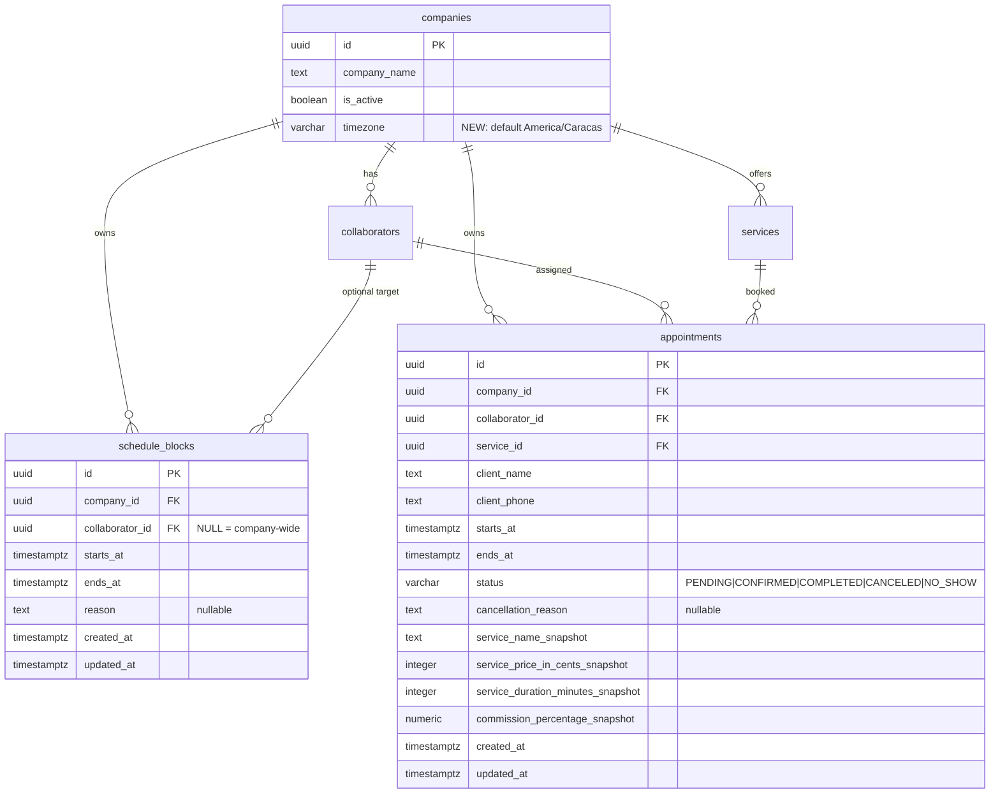
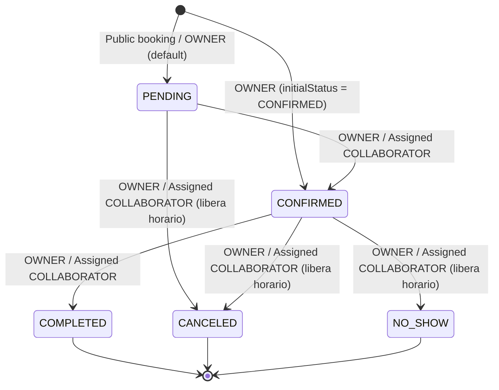

# Data Model: Etapa 3 — Motor de Agendamientos, Disponibilidad y Bloqueios

**Feature**: `002-appointments-availability-blocks`  
**Date**: 2026-11-20

## 1. Diagrama de Entidades y Relaciones

---

## 2. Esquema PostgreSQL / Drizzle (Migración `0004`)

### 2.1 Alteración en `companies` (`companies-schema.ts`)

| Columna | Tipo PostgreSQL | Restricciones | Descripción |
|---|---|---|---|
| `timezone` | `varchar(64)` | `NOT NULL DEFAULT 'America/Caracas'` | Zona horaria IANA de la empresa para interpretar `work_schedules` y fechas locales |

### 2.2 Tabla `schedule_blocks` (`schedule-blocks-schema.ts`)

| Columna | Tipo PostgreSQL | Restricciones | Descripción |
|---|---|---|---|
| `id` | `uuid` | `PRIMARY KEY DEFAULT gen_random_uuid()` | Identificador único del bloqueo |
| `company_id` | `uuid` | `NOT NULL REFERENCES companies(id) ON DELETE CASCADE` | Aislamiento multi-tenant obligatorio |
| `collaborator_id` | `uuid` | `NULL REFERENCES collaborators(id) ON DELETE CASCADE` | `NULL` = bloqueo global de la empresa; UUID = bloqueo de un colaborador |
| `starts_at` | `timestamptz` | `NOT NULL` | Inicio del bloqueo en UTC |
| `ends_at` | `timestamptz` | `NOT NULL` | Fin del bloqueo en UTC |
| `reason` | `text` | `NULL` | Motivo opcional (ej. "Almuerzo", "Feriado", "Consulta médica") |
| `created_at` | `timestamptz` | `NOT NULL DEFAULT now()` | Auditoría |
| `updated_at` | `timestamptz` | `NOT NULL DEFAULT now()` | Auditoría |

**Constraints e Índices:**
- `CHECK (ends_at > starts_at)` → `schedule_blocks_time_range_chk`
- `INDEX (company_id, starts_at, ends_at)` → `schedule_blocks_company_range_idx`
- `INDEX (company_id, collaborator_id, starts_at, ends_at)` → `schedule_blocks_company_collab_range_idx`

### 2.3 Tabla `appointments` (`appointments-schema.ts`)

| Columna | Tipo PostgreSQL | Restricciones | Descripción |
|---|---|---|---|
| `id` | `uuid` | `PRIMARY KEY DEFAULT gen_random_uuid()` | Identificador único de la cita |
| `company_id` | `uuid` | `NOT NULL REFERENCES companies(id) ON DELETE CASCADE` | Aislamiento multi-tenant obligatorio |
| `collaborator_id` | `uuid` | `NOT NULL REFERENCES collaborators(id) ON DELETE RESTRICT` | Profesional asignado (no se borra si tiene historial) |
| `service_id` | `uuid` | `NOT NULL REFERENCES services(id) ON DELETE RESTRICT` | Servicio reservado |
| `client_name` | `text` | `NOT NULL` | Nombre del cliente final (trim, no vacío) |
| `client_phone` | `text` | `NOT NULL` | Teléfono/WhatsApp normalizado del cliente |
| `starts_at` | `timestamptz` | `NOT NULL` | Inicio de la cita en UTC |
| `ends_at` | `timestamptz` | `NOT NULL` | Fin de la cita en UTC (`starts_at + durationMinutes`, derivado siempre en backend) |
| `status` | `varchar(20)` | `NOT NULL DEFAULT 'PENDING'` | Estado del ciclo de vida |
| `cancellation_reason` | `text` | `NULL` | Motivo opcional cuando pasa a `CANCELED` |
| `service_name_snapshot` | `text` | `NOT NULL` | Nombre del servicio al momento de crear la cita |
| `service_price_in_cents_snapshot` | `integer` | `NOT NULL` | Precio en centavos al momento de crear la cita |
| `service_duration_minutes_snapshot` | `integer` | `NOT NULL` | Duración en minutos al momento de crear la cita |
| `commission_percentage_snapshot` | `numeric(5,2)` | `NOT NULL` | Porcentaje de comisión del colaborador al momento de crear la cita |
| `created_at` | `timestamptz` | `NOT NULL DEFAULT now()` | Auditoría |
| `updated_at` | `timestamptz` | `NOT NULL DEFAULT now()` | Auditoría |

**Constraints e Índices:**
- `CHECK (ends_at > starts_at)` → `appointments_time_range_chk`
- `CHECK (service_duration_minutes_snapshot > 0)` → `appointments_duration_positive_chk`
- `CHECK (service_price_in_cents_snapshot >= 0)` → `appointments_price_non_negative_chk`
- `CHECK (commission_percentage_snapshot >= 0 AND commission_percentage_snapshot <= 100)` → `appointments_commission_range_chk`
- `CHECK (status IN ('PENDING', 'CONFIRMED', 'COMPLETED', 'CANCELED', 'NO_SHOW'))` → `appointments_status_chk`
- `INDEX (company_id, collaborator_id, starts_at, ends_at)` → `appointments_company_collab_range_idx`
- `INDEX (company_id, starts_at)` → `appointments_company_starts_at_idx`
- `INDEX (company_id, status, starts_at)` → `appointments_company_status_starts_at_idx`

---

## 3. Máquina de Estados de `Appointment`

### Reglas de Bloqueo de Horario por Estado
- **Bloquean horario (activas):** `PENDING`, `CONFIRMED`
- **Liberan horario:** `CANCELED`, `NO_SHOW`
- **Histórico finalizado:** `COMPLETED` (no admite cambios ni reprogramación)

---

## 4. Invariantes de Dominio

1. **Solapamiento (`TimeRange.overlaps`):** Dos intervalos `[A.startsAt, A.endsAt)` y `[B.startsAt, B.endsAt)` se solapan si y solo si `A.startsAt < B.endsAt && A.endsAt > B.startsAt`. Intervalos contiguos (`A.endsAt === B.startsAt`) NO se solapan.
2. **Derivación de `endsAt`:** En `create`, `endsAt = new Date(startsAt.getTime() + service.durationMinutes * 60_000)`. En `reschedule`, `endsAt = new Date(newStartsAt.getTime() + appointment.serviceDurationMinutesSnapshot * 60_000)` preservando la duración histórica pactada.
3. **Validación completa de disponibilidad al crear/reprogramar:**
   - `startsAt.getTime() > now.getTime()` (siempre en el futuro).
   - `[startsAt, endsAt)` debe caer dentro del mismo día local en `company.timezone`.
   - Debe existir `WorkSchedule` con `isWorkingDay === true` para ese `dayOfWeek`.
   - `localStartMinutes >= workStartMinutes && localEndMinutes <= workEndMinutes`.
   - Si existe descanso (`breakStart`, `breakEnd`), el intervalo no puede intersectar `[breakStart, breakEnd)`.
   - No puede intersectar ningún `ScheduleBlock` del colaborador ni global (`collaboratorId === null`) de la misma empresa.
   - No puede intersectar ninguna cita activa (`PENDING`, `CONFIRMED`) del mismo colaborador (excluyendo el propio `appointment.id` durante `reschedule`).
4. **Datos del cliente:** `clientName.trim().length >= 2`; `clientPhone` normalizado (sin espacios ni símbolos de formato irrelevantes, mínimo 10 dígitos válidos).
5. **Reprogramación:** Permitida exclusivamente por `OWNER` mientras `appointment.status` sea `PENDING` o `CONFIRMED`.
